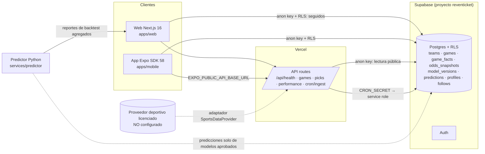

# Arquitectura

## Separación de responsabilidades

| Capa | Dónde | Estado |
| --- | --- | --- |
| Ingesta | `apps/web/app/api/cron/ingest` + `SportsDataProvider` | Contrato y ruta protegida; sin proveedor licenciado (responde 409) |
| Normalización / validación | `packages/shared/src/schemas.ts` (`ProviderGameSchema`), `services/predictor/vanta_predictor/quality.py` | Implementado y probado |
| Almacenamiento histórico | `games`, `game_facts`, `odds_snapshots`, `ingestion_runs`, `data_sources` | Esquema aplicado (seguridad pendiente de confirmación) |
| Features / modelos | `vanta_predictor/models.py` (Elo, Elo-Davidson, Poisson online) | Baselines; MLB/NBA sin datos |
| Predicción y calibración | `backtest.py`, `metrics.py` | Walk-forward, Brier, log loss, ECE, IC bootstrap |
| Selector de picks / gate | `gate.py` + trigger `vanta_guard_predictions` | Ningún modelo aprobado |
| Registro inmutable | triggers `vanta_predictions_guard` / `vanta_block_published_delete` | En migración de seguridad |
| Evaluación de resultados | vista `published_performance` | Lista para cuando haya picks liquidados |
| Explicaciones | `packages/shared/src/explain.ts` | Deterministas, sin LLM (coste IA = 0) |

## Seis deportes

| Deporte | Baseline previsto | Dataset de investigación | Estado del modelo |
| --- | --- | --- | --- |
| Liga MX | Elo-Davidson y Poisson de goles | football-data.co.uk (2012→2026, cuotas de cierre) | Evaluado: no publicable |
| Champions League | Igual que fútbol | Ninguno verificado | Sin evaluar |
| LaLiga | Igual que fútbol | Ninguno verificado (descarga de football-data devolvió redirección no seguida) | Sin evaluar |
| NFL | Elo con margen de victoria | nflverse/nfldata (1999→2026, moneylines) | Evaluado: no publicable |
| MLB | Carreras, abridor y bullpen | Ninguno | Sin evaluar |
| NBA | Posesiones, eficiencia y minutos | Ninguno | Sin evaluar |

## Decisiones

- **Sin LLM**: las explicaciones solo reformulan datos recuperados con fuente y hora; no pueden inventar estadísticas ni probabilidades. Elimina el coste de IA.
- **Demo explícito**: las fixtures demo viven en `packages/shared` y siempre llevan `isDemo: true`; la UI muestra "DEMO · ficticio".
- **Zona horaria**: todo se muestra en `America/Mexico_City`.
- **Doble barrera de publicación**: `PREDICTIONS_ENABLED` en la app **y** modelo aprobado en base de datos (RLS + trigger).
