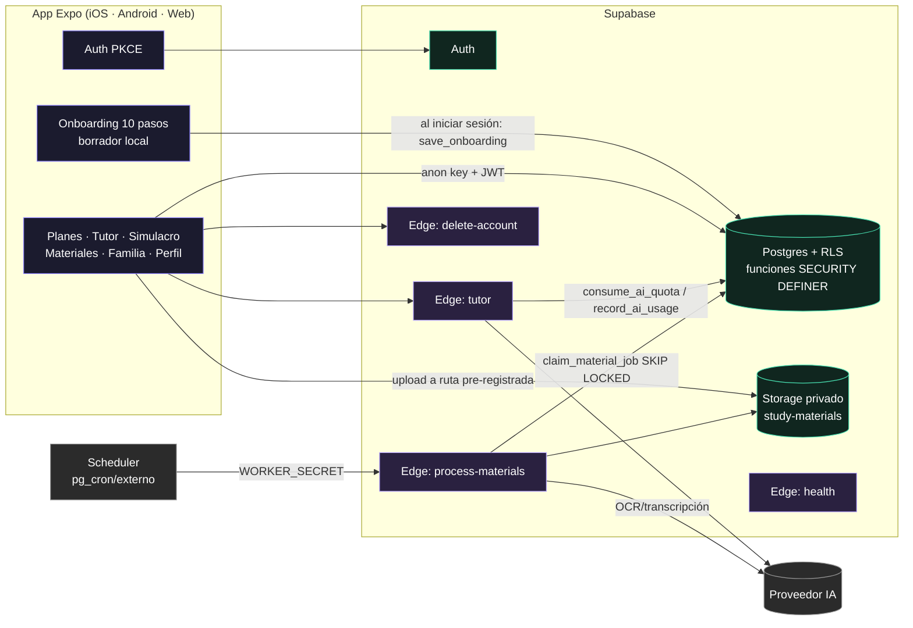
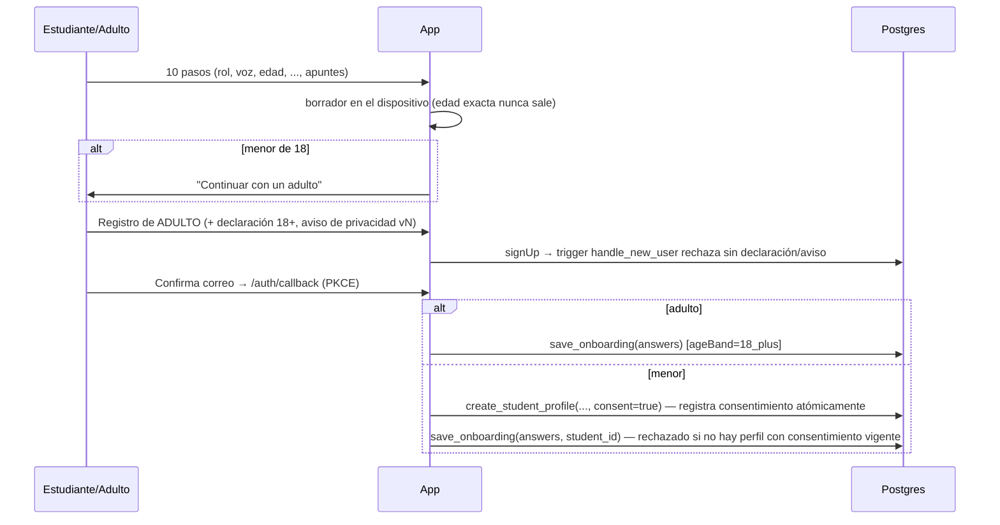

# Arquitectura de StudIA

## Componentes

## Flujos críticos

**Primer uso y protección de menores**

**Material → tutor**: `register_material` (servidor genera `uid/uuid.ext`, valida MIME/tamaño/cuotas) → upload (política de Storage solo acepta rutas pre-registradas `pending_upload`) → `mark_material_uploaded` (verifica metadata real del objeto) → cola `material_jobs` → worker con reintentos y backoff → `ready` → el tutor lo recibe envuelto en `<material>` como dato no confiable.

**Tutor**: JWT → validación de mensajes → filtros de crisis/bloqueo (sin coste) → `consume_ai_quota` atómico por plan + tope global diario → redacción de datos personales → proveedor con timeout y 1 reintento → redacción de salida → `record_ai_usage` (coste estimado, alerta una vez al día). Logs sin contenido.

**Simulacro**: `start_quiz` entrega preguntas sin clave → `submit_quiz` califica en SQL (determinista, una sola vez) → `my_subject_progress` y `family_report` agregan solo intentos reales. Las preguntas `demo` se etiquetan en UI y resultados.

## Principios aplicados

- Denegar por defecto: RLS en todas las tablas, `REVOKE` explícito a `anon`/`authenticated` (Supabase otorga privilegios por defecto) y permisos por columna.
- Escrituras privilegiadas solo mediante funciones `SECURITY DEFINER` con `search_path=''` que revalidan al llamante.
- Ninguna clave privada en el cliente; `service_role` solo en Edge Functions.
- CORS por lista blanca (`APP_ALLOWED_ORIGINS`), CSP estricta en web.
- Mínimos datos: alias en vez de nombre, banda de edad en vez de edad, sin texto de conversaciones en BD ni logs.
- Catálogo curricular con `content_status` y fuente obligatoria para contenido `validated`.

## Decisiones pendientes (requieren a negocio/legal)

- Proveedor y modelo de IA definitivos, región y contrato de tratamiento de datos (DPA).
- Canal de pagos (Apple/Google IAP vs. web) — no implementado a propósito.
- Verificación de identidad del tutor legal (más allá de la declaración en app).
- Códigos de escuela/docente (“Unirme a una preparación”) — visible como “Próximamente”.
- Notificaciones push — no implementadas; requieren consentimiento específico.
